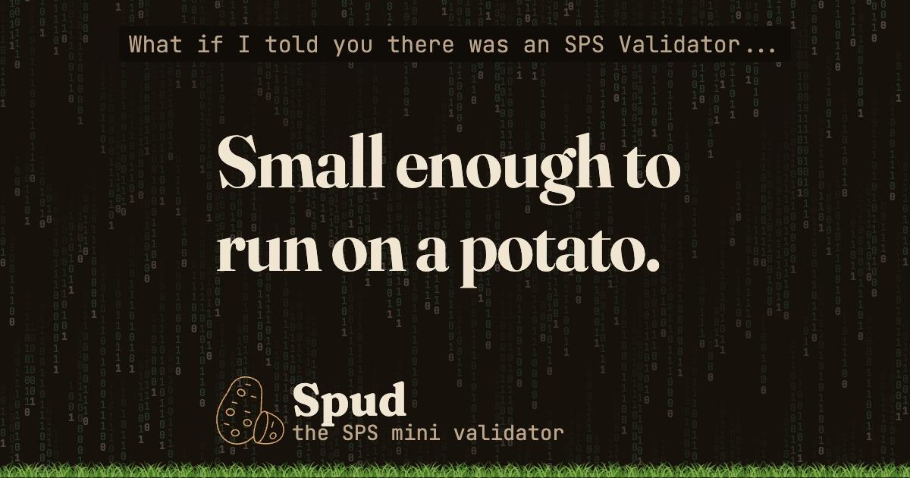

[](https://spudsps.com)

# 🥔 Spud, the SPS mini validator

A minimal SPS validator, small enough to run on a potato. 

Spud is a minimal SPS validator that eliminates the block explorer and web UI while retaining all validator functions.

Spud solves two pain points with the [TheSPSDAO/SPS-Validator](https://github.com/TheSPSDAO/SPS-Validator) reference validator:

1. The installation process requires a lot of disk space
2. Catching up to head takes a long time

The mini validator does not include a web interface, a block explorer, or the database needed to power them. These features provide value but are not required to validate blocks. Eliminating them means everything else is faster and smaller.

## Quick Start

### 1. Docker Install

```sh
curl -fsSL https://raw.githubusercontent.com/spudsps/spudsps-validator/main/install.sh | sh
```

### 2. Add Account

```sh
spud add
```

### 3. Check Spud Status

```sh
spud status
```

See [spudsps.com/install](https://spudsps.com/install/) for complete instructions.

## Publisher

Published by [nullfame](https://github.com/nullfame) under the [MIT license](LICENSE.txt).